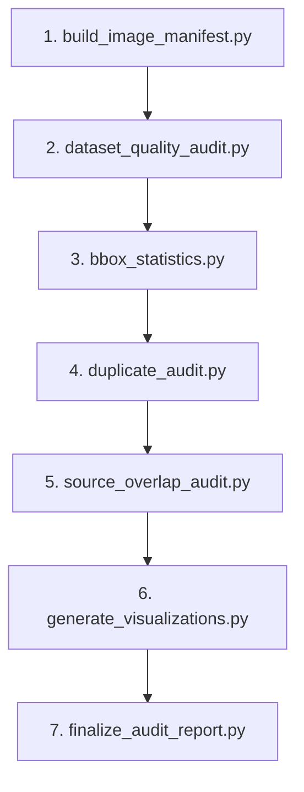

# Lunar CV Data Preprocessing & Quality Audit Pipeline

This directory contains the production data preprocessing and quality auditing pipeline for the Lunar Computer Vision project (detecting craters and rilles on lunar surface imagery).

## Pipeline Architecture & Execution Stages

The pipeline is organized into 7 sequential, non-destructive stages:



---

### Stage 1: `build_image_manifest.py`
- **Purpose:** Constructs an exhaustive image-level inventory of all splits (`train`, `valid`, `test`), verifying image readability and validating YOLO annotation syntax.
- **Inputs:** `train/`, `valid/`, `test/` images and labels.
- **Outputs:** `reports/isro/automated_audit/batch_review/image_level_manifest.csv`
- **Parameters:** `--root` (project root), `--output` (manifest CSV destination).

### Stage 2: `dataset_quality_audit.py`
- **Purpose:** Performs comprehensive structural checks against `data.yaml`. Verifies class IDs, coordinate normalization (`[0, 1]`), positive bounding box dimensions, absence of NaN/inf coordinates, and flags large boxes (relative area $\ge 25\%$ and $\ge 50\%$).
- **Inputs:** `data.yaml`, `train/`, `valid/`, `test/`.
- **Outputs:**
  - `reports/isro/split_summary.csv`
  - `reports/isro/class_distribution.csv`
  - `reports/isro/bbox_statistics.csv`
  - `reports/isro/large_bbox_review.csv`
  - `reports/isro/issues.csv`
  - `reports/isro/dataset_summary.json`

### Stage 3: `bbox_statistics.py`
- **Purpose:** Computes statistical distributions (mean, median, 90th percentile, 95th percentile, maximum area, aspect ratios) per class and per split.
- **Inputs:** `train/labels`, `valid/labels`, `test/labels`.
- **Outputs:** `reports/isro/bbox_distribution_statistics.csv`.

### Stage 4: `duplicate_audit.py`
- **Purpose:** Identifies exact byte duplicates (SHA-256) and perceptual near-duplicate candidates using 64-bit difference hashing (`dHash`) with a configurable Hamming distance threshold ($\le 4$). Generates multi-split prefix groups.
- **Dependencies:** Self-contained Pillow (no external `imagehash` library required).
- **Outputs:**
  - `reports/isro/automated_audit/exact_duplicate_pairs.csv`
  - `reports/isro/automated_audit/near_duplicate_candidates.csv`
  - `reports/isro/automated_audit/cross_split_prefix_groups.csv`
  - `reports/isro/automated_audit/unreadable_images.csv`
  - `reports/isro/automated_audit/summary.json`

### Stage 5: `source_overlap_audit.py`
- **Purpose:** Screens cross-split prefix groups (Train vs. Test, Train vs. Validation) using SIFT keypoint detection and RANSAC homography estimation. Identifies candidate source imagery overlap and generates visual contact sheets.
- **Inputs:** `cross_split_prefix_groups.csv`, dataset images.
- **Outputs:**
  - `reports/isro/automated_audit/batch_review/train_test_sift_pair_results.csv`
  - `reports/isro/automated_audit/batch_review/train_test_group_summary.csv`
  - `reports/isro/automated_audit/batch_review/train_valid_sift_review.csv`
  - Contact sheets in `reports/isro/automated_audit/batch_review/contact_sheets/`

### Stage 6: `generate_visualizations.py`
- **Purpose:** Renders ground-truth YOLO bounding boxes with class tags on sample images and compiles contact sheets for visual quality inspection.
- **Inputs:** `data.yaml`, split images and labels.
- **Outputs:**
  - `reports/isro/visualizations/samples/`
  - `reports/isro/visualizations/train_contact_sheet.jpg`
  - `reports/isro/visualizations/valid_contact_sheet.jpg`
  - `reports/isro/visualizations/test_contact_sheet.jpg`
  - `reports/isro/visualizations/all_splits_contact_sheet.jpg`

### Stage 7: `finalize_audit_report.py`
- **Purpose:** Consolidates all metrics, findings, and notes into executive reports and final project handoff documentation.
- **Inputs:** All previous stage CSVs and JSONs.
- **Outputs:**
  - `reports/isro/dataset_quality_report.md`
  - `reports/isro/qc_summary.json`
  - `reports/isro/automated_audit/batch_review/source_overlap_findings.md`
  - `reports/isro/final_dataset_audit_handoff.md`

---

## PowerShell Execution Pipeline

Run the complete pipeline from the project root in Windows PowerShell:

```powershell
# Set Python executable from project virtual environment
$py = ".\.venv\Scripts\python.exe"

# Stage 1: Build Image Manifest
& $py src/preprocessing/build_image_manifest.py

# Stage 2: Dataset Quality & Structural Audit
& $py src/preprocessing/dataset_quality_audit.py

# Stage 3: Bounding-Box Distribution Statistics
& $py src/preprocessing/bbox_statistics.py

# Stage 4: Exact & Perceptual Duplicate Screening
& $py src/preprocessing/duplicate_audit.py

# Stage 5: Cross-Split Source Overlap SIFT Screening
& $py src/preprocessing/source_overlap_audit.py

# Stage 6: Render Visualizations & Contact Sheets
& $py src/preprocessing/generate_visualizations.py

# Stage 7: Finalize Quality Reports & Handoff
& $py src/preprocessing/finalize_audit_report.py
```

---

## Python Dependencies

All scripts are tested and run using Python 3.11 with the project's existing `.venv`:
- `opencv-python` (cv2): SIFT feature extraction and homography estimation.
- `pillow` (PIL): Image loading, dimension checks, perceptual hashing (`dHash`), and contact sheets.
- `pyyaml`: Parsing `data.yaml`.
- `pandas` / `numpy`: Tabular data handling and matrix calculations.

No extra or uninstalled dependencies (such as external `imagehash`) are required.

---

## Critical Audit Limitations

1. **Source Overlap Classification:**
   - **Probable Source Overlap:** The train-test candidate groups `Screenshot-2022-02-25-15-00-39_png_jpg` (1,272 inliers) and `Screenshot-2022-02-25-15-01-32_png_jpg` (1,104 inliers) exhibit strong evidence of shared underlying lunar scenes.
   - **Inconclusive Candidates:** Groups such as `102_png_jpg`, `14-05-01`, `14-12-12`, and `16-19-45` have weak or partial feature correspondences and remain unresolved.
   - **No Leakage-Free Claim:** Automated checks and prefix screening do not rule out all source-level leakage. Never claim the dataset is completely leakage-free.
2. **Dataset Immutability:**
   - Under no circumstances does this pipeline delete, move, augment, or modify dataset images, labels, or splits.
